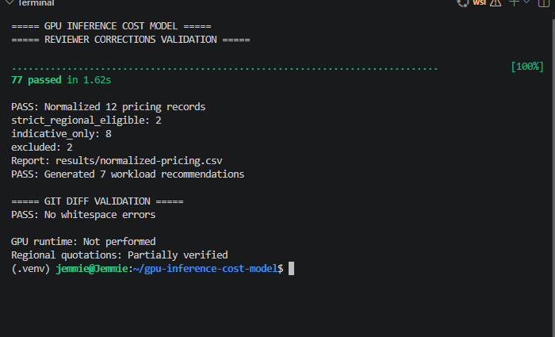

# GPU Inference Cost Model

## Overview

A reproducible multi-cloud GPU inference cost model for
capacity planning, pricing analysis and cost per million
output tokens across AWS, GCP, Lambda, RunPod, Modal
and Replicate.

The project evaluates modeled costs, not measured GPU
inference performance.

## Architecture

Model Configuration → Memory Assessment → Pricing Normalization
→ Cost Analysis → Workload Recommendations → Validation

## Model Portfolio

| Model | Precision | Configured GPUs |
|---|---|---:|
| Qwen3-0.6B | BF16 | 1 |
| Qwen3-8B | BF16 | 1 |
| Llama-3.1-8B-Instruct | AWQ INT4 | 1 |
| Qwen3-32B-AWQ | INT4 | 1 |
| Llama-3.3-70B-Instruct | BF16 | 4 |

Qwen2.5 configurations have been removed.
Memory compatibility is estimated, not runtime-verified.

## Deployment Configuration

vLLM image: `vllm/vllm-openai:v0.33.0`

The explicit version is configured consistently in
Docker Compose and Kubernetes. Deployment files are
statically validated; live GPU execution has not occurred.

## Pricing Methodology

The model evaluates dedicated, Spot and serverless
pricing separately using historical USD rates.

Dedicated inference cost:

`USD/M tokens = hourly cost × 1,000,000 /
(assumed tokens/sec × utilization × 3600)`

Prices retain their capture dates, source URLs, billing
scope, geographic metadata and verification status.

### Regional Normalization

Target market: United States.

| Pricing classification | Configurations |
|---|---:|
| Strict regional eligibility | 2 |
| Indicative only | 8 |
| Excluded from comparison | 2 |

Strict regional eligibility requires documented regional
applicability and compatible billing scope.

The recommendation engine consumes normalized pricing,
prioritizes strictly eligible regional rates and excludes
incomplete billing scopes.

These classifications reflect the project's validation
policy, not independently verified current market quotes
for every provider.

## Performance Assumptions

| Input | Modeled scenarios |
|---|---|
| Throughput | 50, 100, 200 output tokens/sec |
| Utilization | 25%, 50%, 75%, 100% |
| Infrastructure overhead | 0%, 10%, 20% |
| Cold start | 0, 5, 15, 30 seconds |
| Empirical latency | Unmeasured |

Overhead and cold-start values are author-defined
sensitivity scenarios, not provider-published guarantees.

Their rationale, supporting references and limitations
are documented in
[Performance Assumptions](docs/performance-assumptions.md).

## Workload Recommendations

The following are conditional model outputs, not
empirically benchmarked performance rankings.

Dedicated reference: 100 assumed output tokens/sec,
75% utilization and 0% additional overhead.

| Use case | Provider | Model | USD/M output tokens |
|---|---|---|---:|
| Lightweight routing | GCP | Qwen3-0.6B | $3.71 |
| General-purpose inference | RunPod* | Qwen3-8B | $4.04 |
| Lightweight Spot batch | GCP | Qwen3-0.6B | $2.22 |
| Memory-efficient 8B | GCP | Llama-3.1-8B AWQ | $3.71 |
| Quantized 32B inference | RunPod* | Qwen3-32B-AWQ | $4.04 |
| Intermittent serverless | Replicate* | Qwen3-8B | $28.79 |
| Multi-GPU 70B | No eligible configuration | Llama-3.3-70B | N/A |

*Indicative pricing; regional verification or deployment
validation remains outstanding.

The serverless scenario assumes 256 output tokens,
100 tokens/sec, a five-second cold start and zero idle
seconds. Its model deployment remains unverified.

See [Detailed Recommendations](results/recommendations.md).

## Analytical Coverage

| Metric | Result |
|---|---:|
| Providers | 6 |
| Pricing configurations | 12 |
| Dedicated cost scenarios | 288 |
| Serverless cost scenarios | 144 |
| Model-specific cost scenarios | 216 |
| Total modeled cost scenarios | 648 |
| Utilization scenarios | 24 |
| Model-GPU memory assessments | 25 |
| Performance assumption records | 75 |
| Workload recommendations | 7 |

Scenario coverage is not empirical validation.

## Software Validation

77 automated tests passed locally, covering cost
calculations, pricing provenance, regional normalization,
recommendation eligibility, deployment configuration,
model sizing and assumption traceability.

GitHub Actions validates the code on Python 3.10
and 3.12. Results for this revision require a new
successful workflow run.

## Reports

- [Provider Comparison](results/provider-comparison.md)
- [Normalized Pricing](results/normalized-pricing.csv)
- [Dedicated Costs](results/cost-comparison.csv)
- [Serverless Costs](results/serverless-comparison.csv)
- [Model-Specific Costs](results/model-cost-comparison.csv)
- [Recommendations](results/recommendations.md)
- [GPU Memory Estimates](results/model-compatibility.csv)
- [Performance Assumptions](results/performance-assumptions.csv)

## Reproduce

Run `make install` followed by `make check`.

Report generation does not require paid GPU resources.
Historical prices are not automatically refreshed.

## Documentation

- [Architecture](docs/architecture.md)
- [Methodology](docs/methodology.md)
- [Pricing Sources](docs/pricing-sources.md)
- [Performance Assumptions](docs/performance-assumptions.md)
- [Deployment Guide](docs/model-deployment.md)
- [Decision Guide](docs/decision-guide.md)
- [Infrastructure](infrastructure/README.md)

## Validation Evidence

## Limitations

- No empirical GPU throughput, latency or model-quality tests.
- vLLM GPU runtime compatibility remains unverified.
- Regional quotes remain incomplete across providers.
- Historical prices require refreshing before procurement.
- Serverless billing and deployment compatibility remain
  provider-dependent.
- Multi-GPU 70B serving requires separate pricing and testing.

Results are intended for preliminary FinOps planning and
sensitivity analysis, not production cost guarantees.
