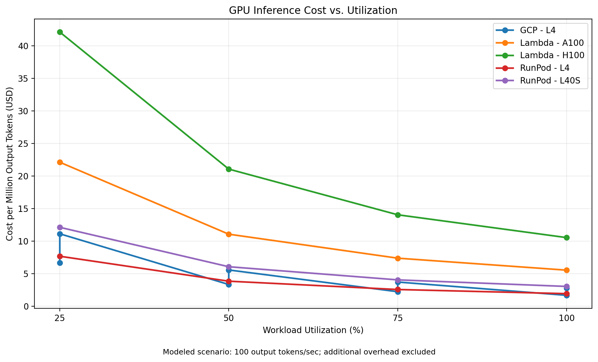
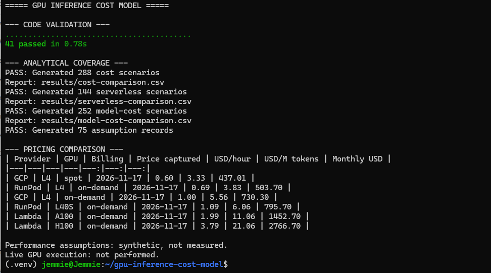

# GPU Inference Cost Model

## Overview

A reproducible multi-cloud GPU inference cost model
for infrastructure pricing, token economics, GPU memory
sizing, and deployment planning.

Providers: AWS, GCP, Lambda, RunPod, Modal, and Replicate.

No empirical GPU inference runs were performed.

## Architecture

Pricing & Assumptions → GPU Memory Screening →
Cost Modeling → Sensitivity Analysis → Reports

## Model Portfolio

| Model | Precision | Configured GPUs |
|---|---|---:|
| Qwen3-0.6B | BF16 | 1 |
| Qwen2.5-7B-Instruct | BF16 | 1 |
| Llama-3.1-8B-Instruct | AWQ INT4 | 1 |
| Qwen2.5-32B-Instruct | AWQ INT4 | 1 |
| Llama-3.3-70B-Instruct | BF16 | 4 |

Memory fit is estimated, not runtime-verified.

## Pricing and Assumptions

| Parameter | Value |
|---|---|
| Pricing snapshot | 2026-11-17 |
| Currency | USD |
| Output throughput | 50, 100, 200 tokens/sec |
| Throughput source | Author-defined synthetic assumptions |
| Workload utilization | 25–100% |
| Infrastructure overhead | 0–20% |
| Cold-start duration | 0–30 seconds |
| Empirical latency | Unmeasured |

Throughput assumptions are not vendor-reported,
hardware-calibrated, or empirically measured.

Pricing-derived CSVs include capture dates, source URLs,
and verification status. AWS secondary-source rates
remain provisional.

## Cost Methodology

USD/M output tokens = Effective hourly cost × 1,000,000 /
(Assumed throughput × Utilization × 3600)

Serverless scenarios incorporate assumed generation time,
cold starts, and billable idle duration.

Pricing and performance uncertainty propagate into
the resulting cost estimates.

## Coverage

| Metric | Count |
|---|---:|
| Cloud providers | 6 |
| Pricing configurations | 12 |
| LLM configurations | 5 |
| GPU profiles | 5 |
| Dedicated cost scenarios | 288 |
| Serverless cost scenarios | 144 |
| Model-specific cost scenarios | 252 |
| Total modeled cost scenarios | 684 |
| Utilization sensitivity scenarios | 24 |
| GPU memory assessments | 25 |
| Performance assumption records | 75 |

Scenario counts represent analytical coverage,
not empirical validation.

## Code Validation

**41 automated tests passed locally.**

Tests cover cost calculations, input handling,
simulated HTTP integration, memory estimation,
pricing provenance, and assumption traceability.

They validate software behavior within tested cases,
not the accuracy of market prices or GPU performance.

## Cost Sensitivity

## Reports

| Analysis | Output |
|---|---|
| Provider comparison | [Markdown](results/provider-comparison.md) |
| Pricing dataset | [CSV](configs/providers/pricing.csv) |
| Dedicated costs | [CSV](results/cost-comparison.csv) |
| Serverless costs | [CSV](results/serverless-comparison.csv) |
| Model-specific costs | [CSV](results/model-cost-comparison.csv) |
| Utilization sensitivity | [CSV](results/utilization-sensitivity.csv) |
| GPU memory assessments | [CSV](results/model-compatibility.csv) |
| Performance assumptions | [CSV](results/performance-assumptions.csv) |

## Infrastructure

Docker Compose and Kubernetes configurations are
defined and statically checked, but not executed on GPUs.

The vLLM measurement runner supports future empirical
validation. See [Infrastructure](infrastructure/README.md).

## Reproduce

Run `make install` followed by `make check`.

No GPU resources are required for report generation.
Regeneration does not refresh historical pricing.

## Documentation

[Architecture](docs/architecture.md) |
[Methodology](docs/methodology.md) |
[Pricing Sources](docs/pricing-sources.md) |
[Performance Assumptions](docs/performance-assumptions.md) |
[Model Deployment](docs/model-deployment.md) |
[Decision Guide](docs/decision-guide.md)

## Validation Evidence

## Limitations

- No measured GPU throughput or latency.
- Memory fit and token costs are modeled estimates.
- Provider pricing requires periodic revalidation.
- Serverless billing is not fully provider-calibrated.
- The 70B model is excluded from single-GPU cost scenarios.

Results support preliminary capacity planning and
cost analysis, not production cost guarantees.
