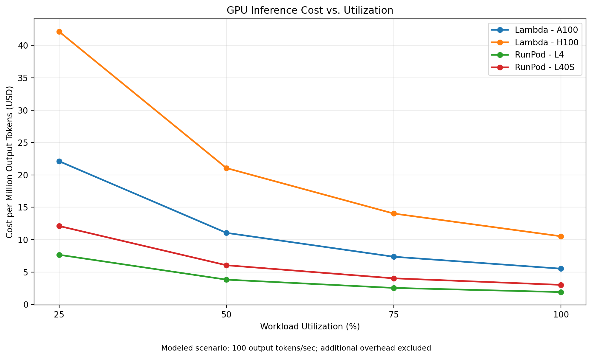

# GPU Cost Comparison

## Dedicated GPU Economics

Modeled workload: 100 output tokens/sec, 50% utilization, excluding additional overhead.

| Provider | GPU | USD/hour | USD/M tokens | Monthly USD |
|---|---|---:|---:|---:|
| RunPod | L4 | 0.69 | 3.83 | 503.70 |
| RunPod | L40S | 1.09 | 6.06 | 795.70 |
| Lambda | A100 | 1.99 | 11.06 | 1452.70 |
| Lambda | H100 | 3.79 | 21.06 | 2766.70 |

## Utilization Analysis

## Limitations

- Throughput values are modeled assumptions.
- Unverified prices are excluded from rankings.
- Serverless economics are reported separately.
- Live GPU performance remains unverified.
